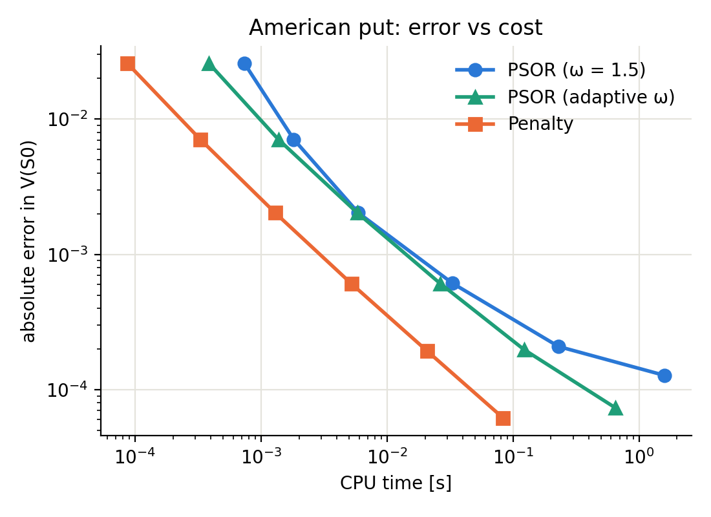
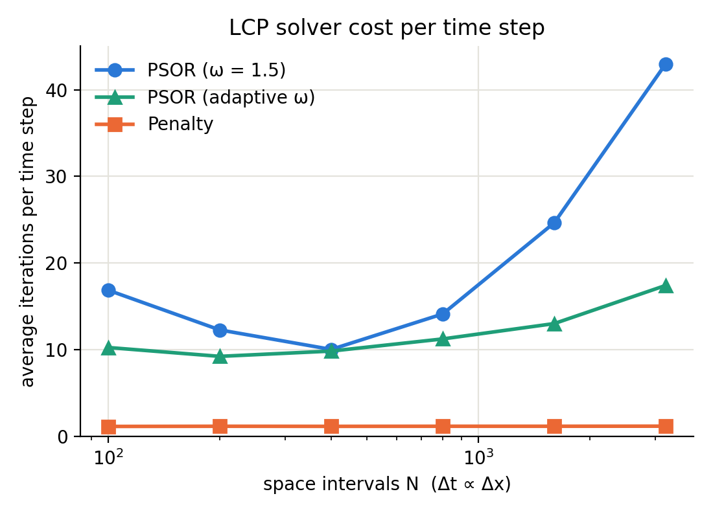

# American Derivatives Solver

A small C++17 library that prices European and American options by solving the **Black–Scholes PDE with finite differences**. Early exercise turns pricing into a free boundary problem, which at every time step becomes a linear complementarity problem (LCP). The repository solves it with two classical methods, **projected SOR** and the **penalty method**, and compares them on the same grid and the same discretization.

It was built as a first multi-file C++ project, with tests, a benchmark and a CMake build that works on Windows (Visual Studio), Linux and macOS.



## The problem

With $x = \ln S$ and time to maturity $\tau = T - t$, the price $u(x,\tau)$ of an American option with payoff $g$ satisfies

$$
\min\big(u_\tau - \mathcal{L}u,\; u - g\big) = 0, \qquad u(x,0) = g(x),
$$

where

$$
\mathcal{L}u = \tfrac12\sigma^2 u_{xx} + \big(r - q - \tfrac12\sigma^2\big) u_x - r u .
$$

In the continuation region the Black–Scholes equation holds, and in the exercise region the price equals the payoff. In log-price the coefficients are constant, so a uniform grid is natural and the matrices are assembled only once.

## Numerical method

- **Grid.** Uniform in $x$, centered at $\ln K$ with half width $6\sigma\sqrt{T}$, so that the strike is always a grid node.
- **Time stepping.** Crank–Nicolson with **Rannacher start-up**. The first two Crank–Nicolson steps are replaced by four implicit Euler half steps. Crank–Nicolson does not damp high frequencies, and the kink of the payoff at $K$ would otherwise produce oscillations, mostly visible in $\Gamma$, and degrade the convergence order.
- **Discontinuous payoffs** (binaries). At the strike node the initial condition takes the average of the one-sided limits, and the obstacle takes their maximum (at $S = K$ the holder can exercise and collect the higher side).
- **Boundary conditions.** Dirichlet, with the asymptotic European value of each payoff as $S \to 0$ and $S \to \infty$ (and its maximum with the payoff in the American case).
- **Greeks.** $\Delta$ and $\Gamma$ from a quadratic interpolation through the three grid nodes closest to $S_0$.

At every time step the American problem is the discrete LCP

$$
Au - b \ge 0, \qquad u - g \ge 0, \qquad (Au - b)^\top (u - g) = 0,
$$

with $A$ tridiagonal. The two solvers share everything else, so the comparison only measures how this LCP is solved.

- **PSOR.** Projected Gauss–Seidel with over-relaxation $\omega = 1.5$, started from the previous time step and stopped when the relative change between sweeps is below the tolerance.
- **Penalty.** The constraint is replaced by a penalty term $\rho \max(g - u, 0)$, solved with a Newton-type iteration

$$
\big(A + P(u^k)\big)\, u^{k+1} = b + P(u^k)\, g, \qquad P(u)_{ii} = \rho\, \mathbf 1_{\{u_i < g_i\}},
$$

so each iteration is a single tridiagonal (Thomas) solve. The iteration stops when the set of penalized nodes does not change. We take $\rho = 1/\text{tol}$ with $\text{tol} = 10^{-8}$; larger penalties can make the active set cycle due to round-off.

## Payoffs

| Payoff | $g(S)$ |
|---|---|
| Call | $\max(S - K, 0)$ |
| Put | $\max(K - S, 0)$ |
| Cash-or-nothing call / put | $Q\,\mathbf 1_{\{S > K\}}$ / $Q\,\mathbf 1_{\{S < K\}}$ |
| Asset-or-nothing call | $S\,\mathbf 1_{\{S > K\}}$ |
| Straddle | $\lvert S - K \rvert$ |

All of them can be priced with European or American exercise. A new payoff only needs a class deriving from `Payoff` with its intrinsic value and its far-field value.

## Validation

`tests/test_solver.cpp` checks:

- every European payoff against the Black–Scholes closed form, and $\Delta$, $\Gamma$ of the call;
- second order convergence in the European case (error ratio $\approx 4$ when the grid is halved);
- the American call without dividends equals the European call;
- PSOR and penalty give the same price on the same grid;
- American put, call and straddle against a Cox–Ross–Rubinstein binomial tree;
- American binaries against the closed-form one-touch price (Reiner–Rubinstein);
- $V_{\text{American}} \ge V_{\text{European}}$ and $V \ge g$ on the whole grid.

## Results

American put with $S_0 = K = 100$, $r = 0.05$, $q = 0$, $\sigma = 0.3$, $T = 1$, refining the grid with $\Delta t \propto \Delta x$. The reference value is a penalty run on a $16000 \times 8000$ grid.

| $N$ | PSOR error | penalty error | PSOR sweeps/step | penalty solves/step | PSOR time (s) | penalty time (s) |
|---:|---:|---:|---:|---:|---:|---:|
| 100  | 2.6e-2 | 2.6e-2 | 16.9 | 1.17 | 0.0010 | 0.0001 |
| 200  | 7.1e-3 | 7.1e-3 | 12.3 | 1.19 | 0.0031 | 0.0004 |
| 400  | 2.0e-3 | 2.0e-3 | 10.1 | 1.18 | 0.011  | 0.0017 |
| 800  | 6.1e-4 | 6.1e-4 | 14.1 | 1.19 | 0.062  | 0.0087 |
| 1600 | 2.1e-4 | 1.9e-4 | 24.7 | 1.19 | 0.39   | 0.027  |
| 3200 | 1.3e-4 | 6.2e-5 | 43.0 | 1.20 | 2.75   | 0.11   |



The main observations:

- The penalty method needs about one tridiagonal solve per time step, independently of the grid, so its cost scales like $O(NM)$. PSOR needs more and more sweeps as the grid is refined (the spectral radius of the iteration tends to 1), and on the finest grid it is about 25 times slower.
- On fine grids PSOR is also **less accurate** with the same tolerance. Its stopping rule measures the change between sweeps, which underestimates the actual error when the iteration converges slowly.
- The penalty error ratios when doubling $N$ are between 3 and 3.6, between first and second order. This is expected, since the solution is only $C^1$ across the free boundary and the free boundary is not aligned with the grid. In the European case the ratio is 4.

Times are from a single machine and change from one computer to another; the ratios between methods are what matters.

## Quick start

Requirements: a C++17 compiler and CMake ≥ 3.16. Python 3 with matplotlib for the plots.

```bash
git clone https://github.com/cesaramr314/American_Derivatives_Solver.git
cd American_Derivatives_Solver
cmake -S . -B build -DCMAKE_BUILD_TYPE=Release
cmake --build build -j
ctest --test-dir build --output-on-failure        # tests
./build/amopt_price                               # price table for all payoffs
./build/amopt_benchmark results/benchmark.csv     # PSOR vs penalty (~15 s)
python3 scripts/plot_benchmark.py results/benchmark.csv
```

On Windows, open the folder in Visual Studio (*Open a local folder*). `CMakePresets.json` provides the *x64 Debug* and *x64 Release* configurations; use Release for the benchmark.

Minimal usage of the library:

```cpp
#include "amopt/lcp.hpp"
#include "amopt/pde_solver.hpp"

amopt::OptionSpec opt;                      // S0 = 100, r = 0.05, sigma = 0.2, T = 1
opt.exercise = amopt::Exercise::American;
amopt::PutPayoff put(100.0);
amopt::PenaltySolver penalty;               // or amopt::PsorSolver psor;
amopt::GridConfig cfg;                      // 400 x 200 grid

auto res = amopt::price_pde(opt, put, cfg, &penalty);
// res.price, res.delta, res.gamma, res.iterations, res.seconds
```

## Repository structure

```
include/amopt/   headers: payoffs, tridiagonal solver, LCP solvers, PDE solver
src/             implementation of the library
apps/            price.cpp (price table) and benchmark.cpp (PSOR vs penalty)
tests/           validation tests, run with CTest
scripts/         plot_benchmark.py
results/         benchmark data and figures
```

## References

- C. W. Cryer. The solution of a quadratic programming problem using systematic overrelaxation. *SIAM J. Control* 9 (1971).
- P. A. Forsyth, K. R. Vetzal. Quadratic convergence for valuing American options using a penalty method. *SIAM J. Sci. Comput.* 23 (2002).
- R. Rannacher. Finite element solution of diffusion problems with irregular data. *Numer. Math.* 43 (1984).
- D. M. Pooley, K. R. Vetzal, P. A. Forsyth. Convergence remedies for non-smooth payoffs in option pricing. *J. Comput. Finance* 6 (2003).
- P. Wilmott, J. Dewynne, S. Howison. *Option Pricing: Mathematical Models and Computation*. Oxford Financial Press (1993).
- J. C. Cox, S. A. Ross, M. Rubinstein. Option pricing: a simplified approach. *J. Financial Economics* 7 (1979).
- E. Reiner, M. Rubinstein. Unscrambling the binary code. *Risk* 4 (1991).

## Use of AI tools

Claude Opus 5.5 (Anthropic) was used extensively for cleaning, optimizing and refactoring the code, and for generating most of the tests and benchmarks. All generated files were reviewed in detail before being included.

## License

See [LICENSE](LICENSE).
